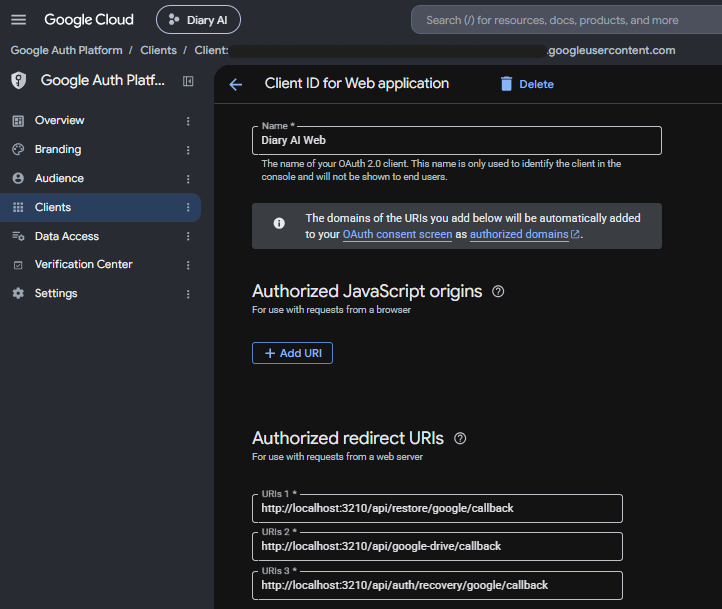
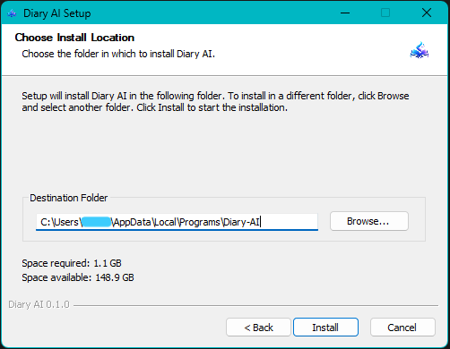

# Diary AI 


**A private, AI-assisted diary for capturing personal reflections, understanding patterns, and preserving entries through backup and restore.**

Diary AI is a full-stack TypeScript application built with Next.js, React, PostgreSQL, and Prisma. The current source includes diary entry management, voice transcription, AI-assisted entry cleanup and analysis, trend reports, text-to-speech narration, account security and recovery workflows, Google Drive backup/restore, and a Windows desktop application built with Electron and an embedded PostgreSQL runtime.

## Contents
- [Features](#features)
- [Architecture](#architecture)
- [Prerequisites](#PREREQUISITES)
- [Configure Diary AI](#configure-diary-ai)
- [Roadmap](#roadmap)
- [Contributing](#contributing)
- [License](#license)

# Features
### (i). Diary and AI
- Create, view, edit, and delete diary entries.
- Store text entries and voice-origin entries, with an original transcript field and a cleaned entry field.
- Record audio in the browser and submit it for transcription through the configured [Cohere tts](https://docs.cohere.com/reference/about) API integration.
- Request AI-assisted cleanup of diary content.
- Generate structured entry analysis, including summaries, mood labels and confidence, topics, important events, action items, and recommendations when returned by the configured model.
- Generate and display trend reports across diary entries.
- Respect per-account privacy preferences for voice transcription, AI processing, and AI trend analysis.
- Use responsive forms, loading states, status feedback, error boundaries, and reusable UI components.

### (ii). Text-to-speech
- Includes a [Sherpa-ONNX](https://k2-fsa.github.io/sherpa/onnx/tts/all/) WebAssembly-based TTS engine and related voice, segmentation, PCM playback, and WAV conversion utilities.
- Provides listen/narration controls and a narration modal.
- TTS runs through the local application assets rather than requiring every narration request to be sent to Cohere.

### (iii). Accounts and recovery
- Account registration and credentials-based login using Auth.js / NextAuth and password hashing with `bcryptjs`.
- Account profile editing and password changes.
- JWT session validation with a database-backed `sessionVersion` check to support invalidating older sessions when the version changes.
- Multi-step account recovery routes for Google verification, backup verification, email OTP verification, and password reset.
- OTP attempt and send-count fields, expiry timestamps, and recovery-session expiry data in the database schema.
- Separate portable-account-restore sessions for restoring an account/diary onto another installation.

### (iv). Backup and Google Drive
- Backup export and encrypted-export routes.
- Backup verification routes.
- Google Drive connection and disconnection flows.
- Google Drive backup listing/restore, restore planning, and verification endpoints.
- Restore account preview, backup selection, email verification, and portable restore flows.
- Encryption helpers for Google tokens and backup payloads.


## Technology stack

| Area                      | Technology                         | Role                                                                  |
| ------------------------- | ---------------------------------- | --------------------------------------------------------------------- |
| Language                  | TypeScript, JavaScript             | Application and desktop code                                          |
| UI                        | React 19                           | Component-based interface                                             |
| Web framework             | Next.js 16.3.3                     | Routing, server/client components, API routes, production server      |
| CSS                       | Tailwind CSS 4, PostCSS            | Responsive interface styling                                          |
| Runtime / package manager | Node.js, npm                       | Development and build runtime; dependency installation                |
| Database                  | PostgreSQL                         | Relational storage                                                    |
| ORM                       | Prisma 7.10.0                      | Typed data access and schema/migration tooling                        |
| PostgreSQL adapter        | `@prisma/adapter-pg`, `pg`         | Prisma's PostgreSQL connection                                        |
| Authentication            | Auth.js / `next-auth` v5 beta      | Credentials authentication and JWT sessions                           |
| Password hashing          | `bcryptjs`                         | Password hash verification and hashing                                |
| Validation                | Zod 4                              | Runtime validation                                                    |
| AI integration            | Cohere API                         | AI processing and transcription integration used by configured routes |
| Google integration        | `googleapis`                       | OAuth and Google Drive operations                                     |
| Email                     | Nodemailer                         | SMTP mail delivery for recovery flows                                 |
| Desktop shell             | Electron 44                        | Windows desktop runtime                                               |
| Embedded database         | `embedded-postgres` 18.4.0-beta.17 | Local PostgreSQL runtime for desktop                                  |
| Desktop packaging         | Electron Builder 26                | NSIS Windows installer                                                |
| TTS                       | Sherpa-ONNX WebAssembly assets     | Local/Offline narration engine                                        |
| Linting / types           | ESLint 9, TypeScript 5.9           | Static checks and type safety                                         |
| CI                        | GitHub Actions                     | Windows installer build and artifact/release workflow                 |

## Architecture

### Web application
```text
Browser
  |
  v
Next.js App Router
  ├── Pages and React components
  ├── Server actions
  └── API routes
         |
         v
  Domain schemas (Zod)
         |
         v
  Services / application logic
         |
         v
  Repositories
         |
         v
  Prisma Client + PostgreSQL
```

### External integrations
```text
Diary AI application
  ├── Cohere API
  │     └── Configured AI / transcription operations
  ├── Google OAuth + Google Drive API
  │     └── Backup, restore, and recovery verification
  ├── SMTP provider through Nodemailer
  │     └── Recovery email OTP
  └── Sherpa-ONNX WebAssembly
        └── Local text-to-speech narration
```

### Desktop startup
```text
Electron main process
  ├── Load persistent desktop runtime configuration
  ├── Initialize/start embedded PostgreSQL
  ├── Create diary_ai database if missing
  ├── Construct DATABASE_URL for the local database
  ├── Apply committed Prisma migrations
  ├── Start Next.js standalone server on localhost:3210
  └── Open the login page in a desktop window
```

In the current `electron/main.ts`, the desktop HTTP port defaults to `3210`, while PostgreSQL uses a separately selected local port. `APP_HOST` is `127.0.0.1`; the application URL and OAuth callbacks use `localhost`. 

### Database configuration
- `electron/main.ts` constructs `DATABASE_URL` dynamically for its embedded PostgreSQL process. Do not add the web development database URL to the desktop `.env` without a specific reason grounded in the current implementation.

## Repository layout
```text
.
├── app/
│   ├── (authenticated)/
│   │   ├── dashboard/
│   │   ├── entries/
│   │   ├── settings/
│   │   └── trends/
│   ├── actions/
│   ├── api/
│   │   ├── account/
│   │   ├── ai/
│   │   ├── auth/recovery/
│   │   ├── backup/
│   │   ├── entries/
│   │   ├── google-drive/
│   │   ├── register/
│   │   ├── restore/
│   │   ├── settings/
│   │   └── transcribe/
│   ├── login/
│   ├── recover/
│   ├── register/
│   └── restore/
├── components/
│   ├── auth/
│   ├── branding/
│   ├── diary/
│   ├── navigation/
│   ├── restore/
│   ├── settings/
│   ├── theme/
│   ├── tts/
│   └── ui/
├── domain/
│   ├── ai/
│   ├── auth/
│   ├── backup/
│   ├── diary/
│   └── settings/
├── electron/
│   └── main.ts
├── lib/
│   ├── auth/
│   ├── backup/
│   ├── email/
│   ├── google/
│   ├── tts/
│   └── ...
├── prisma/
│   ├── migrations/
│   ├── schema.prisma
│   └── seed.ts
├── repositories/
├── services/
├── scripts/
│   └── prepare-desktop.mjs
├── public/
│   └── tts/sherpa/
├── workers/
├── build/
│   └── icon.ico
├── .github/workflows/
│   └── build-windows.yml
├── auth.ts
├── auth.config.ts
├── next.config.ts
├── prisma.config.ts
├── package.json
├── package-lock.json
├── electron-builder.yml
├── tsconfig.json
└── tsconfig.electron.json
```

Some directories contain additional files beyond those illustrated above. Generated Prisma client output is written to `generated/prisma/` and is excluded by the repository's `.gitignore`; it is regenerated during setup/build.

## PREREQUISITES
- Download `repository zip`:


## Configure Diary-AI
### 1. Create `.env`
- Diary AI application loads `.env` from its Electron user-data directory. The current `electron/main.ts` uses port `3210` by default, starts its own embedded PostgreSQL instance, and generates/persists these runtime secrets in `desktop-runtime.json` when that file does not already exist
- For this Windows install, the desktop `.env` is typically located at:
```text
%APPDATA%\Diary AI\.env
```

- To create an empty `.env`, open `Terminal` and run the command below. Ensure you're inside Drive C:
  ```bash
  if not exist "%APPDATA%\Diary AI" mkdir "%APPDATA%\Diary AI" & type nul > "%APPDATA%\Diary AI\.env"
  ```

> [!NOTE]
> To locate the `.env` file, navigate to: C:\Users\<YourWindowsUsername>\AppData\Roaming\Diary AI\ .env

- Copy-paste the contents of the sample `.env` below to your `.env`:
```dotenv
# The desktop main process generates DATABASE_URL dynamically.
# Do not set the web-development DATABASE_URL here.

AUTH_SECRET=""
AUTH_TRUST_HOST=true

COHERE_API_KEY="YOUR_COHERE_API_KEY"

GOOGLE_CLIENT_ID="YOUR_CLIENT_ID.apps.googleusercontent.com"
GOOGLE_CLIENT_SECRET="YOUR_CLIENT_SECRET"

GOOGLE_RESTORE_REDIRECT_URI="http://localhost:3210/api/restore/google/callback"
GOOGLE_DRIVE_REDIRECT_URI="http://localhost:3210/api/google-drive/callback"
GOOGLE_RECOVERY_REDIRECT_URI="http://localhost:3210/api/auth/recovery/google/callback"

GOOGLE_TOKEN_ENCRYPTION_KEY="YOUR_BASE64_32_BYTE_KEY"
GOOGLE_RESTORE_TOKEN_ENCRYPTION_KEY=""

SMTP_HOST="smtp.gmail.com"
SMTP_PORT=465
SMTP_USER="YOUR_DEDICATED_GMAIL@gmail.com"
SMTP_APP_PASSWORD="YOUR_GOOGLE_APP_PASSWORD"
SMTP_FROM_NAME="Diary AI"

RECOVERY_OTP_SECRET=""
```

> [!IMPORTANT]
> Empty `AUTH_SECRET`, `RECOVERY_OTP_SECRET`, and `GOOGLE_RESTORE_TOKEN_ENCRYPTION_KEY` values are intentional only because the desktop main process falls back to the persistent generated values for those keys. 

> [!CAUTION]
> Do not delete `desktop-runtime.json` casually: the existing PostgreSQL password and encryption/authentication secrets are tied to the user's local installation.

### 2. Generate application secrets
Run these commands in PowerShell from the project directory. They generate values locally.
> [!NOTE]
> - This step may require you to install Node.js. 
> - If not already installed, Install Node.js from the official download page: <https://nodejs.org/en/download>.
> - Once installed, open terminal and change directory to git-cloned directory `Diary-AI`

- Ensure it is added to [`PATH`](https://gist.github.com/ScribbleGhost/752ec213b57eef5f232053e04f9d0d54), close and reopen PowerShell, and run:
```powershell
node --version
npm --version
```
### Google token encryption key
- Run the command below to generate the `GOOGLE_TOKEN_ENCRYPTION_KEY` and copy-paste the key inside the `.env`:
```powershell
node -e "console.log(require('node:crypto').randomBytes(32).toString('base64'))"
```

- This produces Base64 for 32 random bytes. Use it for `GOOGLE_TOKEN_ENCRYPTION_KEY` only if that code path expects Base64-encoded 32-byte material. 

### 3. Configure Google OAuth and Drive
Google OAuth is used by the Drive connection, backup/restore, and account-recovery flows. The project defines three callback routes per environment. To configure it:
#### 1. Create a Google Cloud project
1. Open <https://console.cloud.google.com/>.
2. Create or select a project dedicated to `Diary AI`.
3. Open **APIs & Services → Library**.
4. Enable **Google Drive API**.

#### 2. Configure OAuth consent
In **Google Auth Platform** (or **APIs & Services → OAuth consent screen**, depending on the console UI):

1. Set the app name `Diary AI` and support/developer contact email.
2. Select the audience appropriate for testing and release.
3. Add tester Google accounts.
4. Review the requested OAuth scopes and request only the access needed by the app.
5. Complete required branding or verification steps.

#### 3. Create OAuth credentials
1. Open **Google Auth Platform → Clients** or **APIs & Services → Credentials**.
2. Create an OAuth client ID of type **Web application** for the current localhost callback architecture.
3. Add `http://localhost:3000` as an authorized JavaScript origin if the Google OAuth flow used by the app requires it.
4. Add these exact URIs to the same OAuth client (as used in the`.env`):
```text
http://localhost:3210/api/restore/google/callback
http://localhost:3210/api/google-drive/callback
http://localhost:3210/api/auth/recovery/google/callback
```

6. Save and copy the client ID and secret into the `.env` file.

#### 4. Configure the environment
```dotenv
GOOGLE_CLIENT_ID="YOUR_CLIENT_ID.apps.googleusercontent.com"
GOOGLE_CLIENT_SECRET="YOUR_CLIENT_SECRET"
GOOGLE_DRIVE_REDIRECT_URI="http://localhost:3000/api/google-drive/callback"
GOOGLE_RECOVERY_REDIRECT_URI="http://localhost:3000/api/auth/recovery/google/callback"
GOOGLE_RESTORE_REDIRECT_URI="http://localhost:3000/api/restore/google/callback"
```

### 5. Configure Cohere
1. Create/sign in to a Cohere account at <https://dashboard.cohere.com/>.
2. Open the API key section and create/copy a key for Diary AI.
3. Add it to the `.env` file:
```dotenv
COHERE_API_KEY="YOUR_COHERE_API_KEY"
```

> [!NOTE]
>  Cohere features require internet connectivity and are subject to the provider's model availability, rate limits, account settings, and pricing. Choose the free trial API Key.

### 6. Configure Gmail SMTP
- The project uses Nodemailer and SMTP settings for recovery email delivery. 
- A Gmail App Password is different from the normal Google account password.
1. Sign in to the Google account (`your-dedicated-account`) that will send recovery messages.
2. Enable 2-Step Verification.
3. Open <https://myaccount.google.com/apppasswords>.
4. Create an app password for Diary AI. The exact Google UI may change.
5. Copy the generated password and replace the value for `SMTP_APP_PASSWORD` 
6. Configure:
```dotenv
SMTP_HOST="smtp.gmail.com"
SMTP_PORT=465
SMTP_USER="your-dedicated-account@gmail.com"
SMTP_APP_PASSWORD="YOUR_GOOGLE_APP_PASSWORD"
SMTP_FROM_NAME="Diary AI"
```

- Your final `.env` file should look something like this:
```dotenv
# The desktop main process generates DATABASE_URL dynamically.
# Do not set the web-development DATABASE_URL here.

AUTH_SECRET=""
AUTH_TRUST_HOST=true

COHERE_API_KEY="cH8vN2qR7mK4xP9wT6jF3bL5sD1aY0uE"

GOOGLE_CLIENT_ID="108765432109-abc123def456ghi789jkl012mno345pq.apps.googleusercontent.com"
GOOGLE_CLIENT_SECRET="GOCSPX-aB7cD9eF2gH4jK6mN8pQ1rS3"

GOOGLE_RESTORE_REDIRECT_URI="http://localhost:3210/api/restore/google/callback"
GOOGLE_DRIVE_REDIRECT_URI="http://localhost:3210/api/google-drive/callback"
GOOGLE_RECOVERY_REDIRECT_URI="http://localhost:3210/api/auth/recovery/google/callback"

GOOGLE_TOKEN_ENCRYPTION_KEY="MDEyMzQ1Njc4OWFiY2RlZjAxMjM0NTY3ODlhYmNkZWY="
GOOGLE_RESTORE_TOKEN_ENCRYPTION_KEY=""

SMTP_HOST="smtp.gmail.com"
SMTP_PORT=465
SMTP_USER="diary.ai.test@gmail.com"
SMTP_APP_PASSWORD="qwer tyui opas dfgh"
SMTP_FROM_NAME="Diary AI"

RECOVERY_OTP_SECRET=""
```


> [!WARNING]
> The values in `.env` directly above are dummy values, not actual working credentials.

### 7. Install Diary-AI-Setup-0.1.0-x64.exe
- Download the official release zip file [here](https://github.com/Lewismwaz/Diary-AI/releases/download/%23Diary-AI-v0.0.1/Diary-AI-Setup-v0.1.0-x64.zip).
- `Extract here` the downloaded file `Diary-AI-Setup-v0.1.0-x64.zip` and open the extracted folder `Diary-AI-Setup-v0.1.0-x64`.
- Run the package installer `Diary-AI-Setup-0.1.0-x64` from the root directory of the extracted folder.
- Click `Next` then `Install` and keep the `Destination Folder` as is.


> [!CAUTION]
> - Do not delete `desktop-runtime.json` as a routine troubleshooting step.
> - Do not delete `postgres-data` without a verified backup and a clear understanding that it contains the local diary database.
>  - Back up the whole user-data directory before destructive maintenance.
>   - Keep runtime configuration and database data together; the database password and encryption keys must remain consistent.

- The installer is configured not to remove user data on uninstall. This is intentional to avoid accidental data loss.

## Roadmap
These features are planned and are **not represented as completed** by this README.
### 1. Automatic idle lock
- Lock the diary after a configurable period of inactivity.
- Require reauthentication before private content is revealed again.
- Handle browser tab switching, application backgrounding, desktop focus changes, and session expiry.
- Preserve unsaved work safely during lock transitions.
- Test timer edge cases, multiple tabs/windows, app resume, expired sessions, and lock bypass attempts.

### 2. Fingerprint biometric authentication
- Support fast sign-in/unlocking on compatible Android devices and fingerprint-enabled laptops, including Windows Hello where supported.
- Use platform authentication APIs and/or WebAuthn/passkeys instead of collecting or storing raw fingerprint data.
- Keep password authentication as a fallback.
- Design recovery when a biometric credential is removed or unavailable.
- Distinguish browser WebAuthn/passkeys from native biometric prompts in a Capacitor app; platform capabilities and integration paths differ.

### 3. Security and privacy hardening
- Review session management, account recovery, expiry, replay prevention, and session invalidation.
- Audit all pages, server actions, and APIs for correct ownership/authorization.
- Prevent lock bypasses and unintended exposure through client state, errors, logs, responses, and local storage.
- Review backup encryption, integrity verification, key management, and restore safety.
- Add automated regression tests for authentication, authorization, recovery, throttling, and restore workflows.
- Review dependencies and production deployment settings.

### 4. Android deployment with Capacitor
- Package the shared React experience for Android using Capacitor after validating compatibility with the Next.js server features and deployment model.
- Define device-local storage and offline behavior.
- Use secure Android credential storage.
- Integrate biometrics where supported, with password fallback.
- Test installation, upgrades, permissions, app lifecycle, offline use, backup/restore, and production builds.
- Generate signed APK/AAB artifacts and document signing-key backup and release management.

### Additional quality goals
- Automated unit, integration, and end-to-end tests.
- CI checks for lint, type safety, database migrations, build, and security regressions.
- Accessibility and performance testing.
- Clear documentation for AI data processing, backup recovery, local data ownership, and account deletion.

## License
This project is licensed under the GNU License. View License [here](https://github.com/Lewismwaz/Diary-AI/blob/main/LICENSE).  
More details about the MIT License can be found [here.](https://choosealicense.com/licenses/mit/)

## Contact
For any inquiries, please contact:
- Email - eappointmaster@gmail.com
- GitHub - [@Lewismwaz](https://github.com/Lewismwaz)  

[Diary AI](https://github.com/Lewismwaz/Diary-AI) **©** 2026, All Rights Reserved
